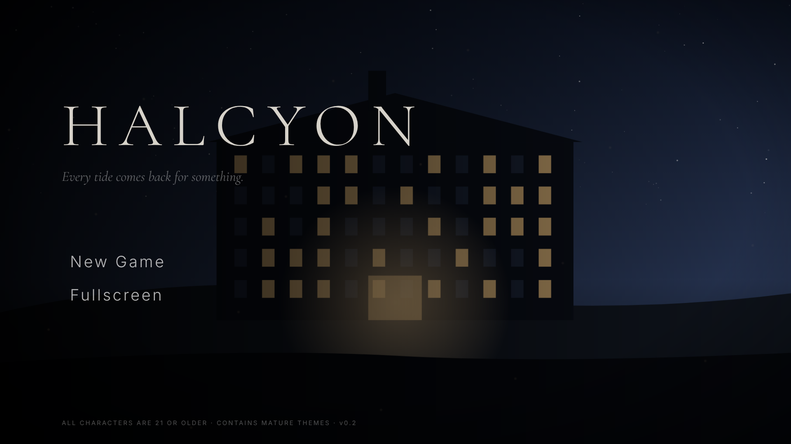
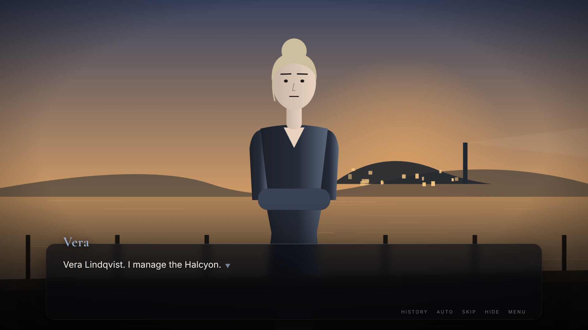
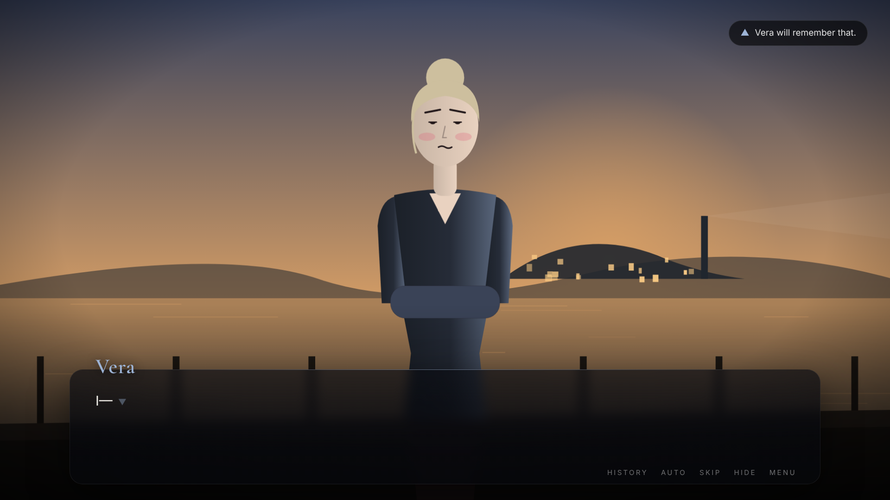

# Halcyon

An original, choice-driven, 3D-rendered visual novel for adults (all characters 21+), built with React,
TypeScript, Vite, Tailwind CSS, Zustand and Framer Motion.

```bash
npm install
npm run dev        # http://localhost:5173
npm test           # engine unit tests + content validation + every-branch playthrough
npm run typecheck
npm run build
```

- Architecture, roadmap and art pipeline: [`docs/ARCHITECTURE.md`](docs/ARCHITECTURE.md)
- Realistic 3D art direction and production pipeline: [`docs/ART_DIRECTION.md`](docs/ART_DIRECTION.md)
- Render checklist for the artist (generated with `npm run brief`): [`docs/RENDER_BRIEF.md`](docs/RENDER_BRIEF.md)
- Story content: `src/data/` (characters, scenes, chapters, asset manifest)
- Engine (pure TypeScript, UI-agnostic): `src/engine/`

**Status:** Phases 1–4 are complete. Chapter One, "Low Tide", is fully playable: about 22–24 minutes,
20 scenes, 30+ choices, four exclusive first-night scenes, a storm, and a cliffhanger. It runs on the
cinematic engine with saves, rollback, relationships and gallery. Placeholder art is procedural until the
89 briefed shots in `docs/RENDER_BRIEF.md` are rendered. Next is Phase 5: audio and polish. Story bible:
[`docs/STORY_CH1.md`](docs/STORY_CH1.md).

**Controls:** Click, Space or Enter to continue · Backspace to go back · A auto · S or hold Ctrl to skip
read text · H or right-click to hide the interface · L or wheel up for history · R for relationships ·
F5 / F9 for quick save / load · Esc for the menu · backtick for the debug panel (dev builds only).

| Main menu | Dialogue | Expressions & relationship notice |
|---|---|---|
|  |  |  |

*Placeholder art is procedural and only previews composition. The target look is photoreal 3D renders (see ART_DIRECTION.md). Renders are drop-in: save an image as `src/assets/shots/<shotId>.webp` and the game shows it, with no code changes.*
